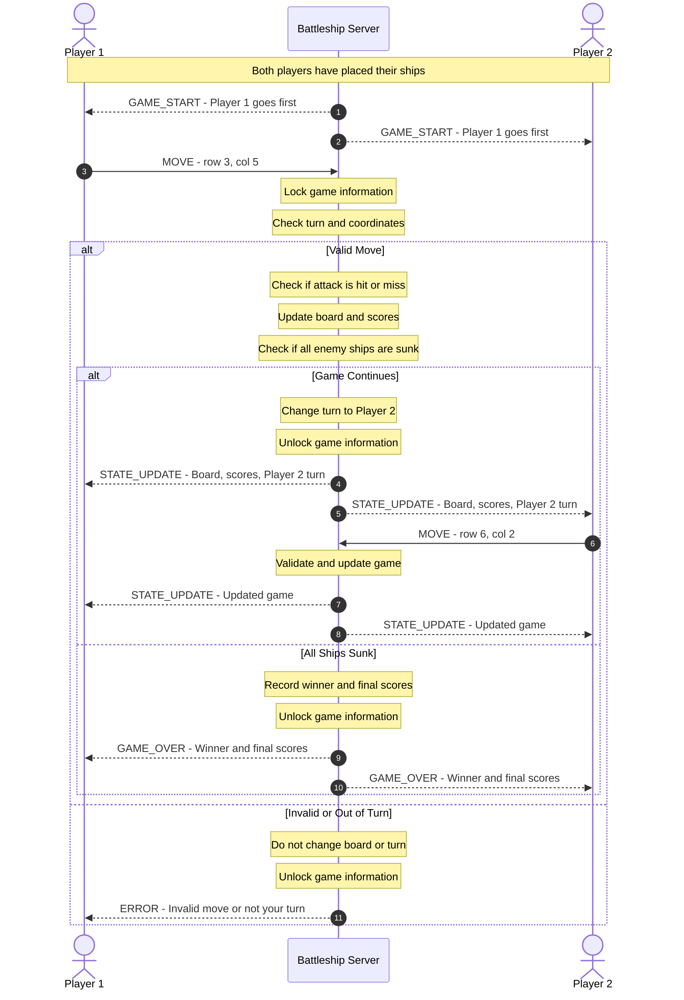

# Battleship State and Score Sequence Diagram

**Course:** CS 457
**Project:** Battleship
**Sprint:** 2

## 1. Overview
-This document explains how the two Battleship players communicate with the server during the game.
-The server handles all game information, including the boards, player turns, hit, misses, and scores.
-When a player makes a move, the server checks if it is valid before updating anything.
-After a valid move, the server sends updated game information to both players so they can see what happened.

## 2. Sequence Diagram
The diagram below shows how Player 1 sends an attack to the server and how the server responds.
It also shows what happens if a player makes an invalid move or attacks when it is not their turn.

## 3. How a Move Works
When it is Player 1's turn, they choose a location on Player 2's board to attack.
Player 1 sends a `MOVE` message containing the row and column.
The server checks:
  1. Is it Player 1's turn?
  2. Are the coordinates between 0 and 9?
  3. Has the player already attacked that location?
  4. Is the game currently accepting moves?
If the move is valid, the server checks whether the attack hits a ship or misses.
The server then updates the board and scores.
If the game is not over, the server changes the turn to Player 2.

## 4. State Updates
After a valid move, the server sends a `STATE_UPDATE` message to both players.
This message includes:

- The result of the attack.
- Updated board informaiton.
- Current hits and misses.
- Number of ships sunk.
- Whose turn it is next.
Each player receives information about their own board and the attacks they have made against the opponent.
Players will not be able to see the other player's hidden ship locations.
Both players receive updates from the same server game state.
The server will place updates into each player's outgoing message queue in the correct order. This helps keep both clients synchronized, even if one connection is slower.

## 5. Invalid Moves and Turn Enforcement
The server is responsible for deciding whether a move is allowed.
If a player attacks outside the 10x10 board , attacks the same location twice, or sends a move when it is not their turn, the server will reject it.
The server sends an `ERROR` message to the player who made the invalid move
The game board and score will not change.
The player whose turn is will still be allowed to make a valid move.
The server uses `threading.Lock` while checking and updating game information so both player threads cannot change the game at the same time.

## 6. Score Synchronization
The server keeps track of the scores for both players.
For Battleship, the server will track:
- Total hits.
- Total misses.
- Ships sunk.
- Games won.
After every valid move, the server updates the scores and sends the new information to both clients through `STATE_UPDATE`.
This makes sure both players receive the same score totals.
If a player sinks all five enemy ships, the server records the winner and sends `GAME_OVER` to both players.
The `GAME_OVER` message contains the winner and final scores.
If a player disconects during the game, the remaining player wins by forfeit.

## 7. Connection to Sprint 1
This diagram follows the protocol and state machine designed in Sprint 1.
The game uses TCP connections and JSON messages ending with `\n`.
The diagram uses the same messages from `protocol_blueprint.md`, including:
- `GAME_START`
- `MOVE`
- `STATE_UPDATE`
- `ERROR`
- `GAME_OVER`
The server also follows the states from `fsm_specfication.md`.
The purpose of this design is to show how the server controls the game, checks player moves, and keeps both clients updated throughout the match.
